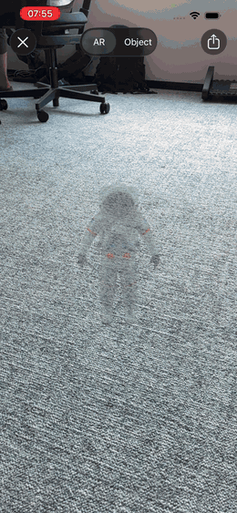

# react-native-ar-preview

<p align="center">
  
</p>

Show 3D models in the **native AR viewer** from React Native - the mobile
version of the "View in AR" button from
[`<model-viewer>`](https://modelviewer.dev).

- **iOS** - opens [AR Quick Look](https://developer.apple.com/augmented-reality/quick-look/) with a USDZ model
- **Android** - opens [Scene Viewer](https://developers.google.com/ar/develop/scene-viewer) with a GLB model

One function call, the platform's own AR experience, **zero runtime
dependencies**. No embedded AR view, no 3D engine, no scene graph.

## Installation

```sh
npm install react-native-ar-preview
```

Then rebuild your app. `pod install` runs through autolinking. On Expo, run
`npx expo prebuild` and make a new development build.

**Requirements:**

- React Native **0.76+** with the **New Architecture** (the default since 0.76).
- Bare React Native or an Expo **development build**. Expo Go does not work - the library ships native code.
- **Android**: the device needs [Google Play Services for AR](https://play.google.com/store/apps/details?id=com.google.ar.core), and the GLB model must be an **HTTPS** URL because Scene Viewer downloads it itself.
- **iOS**: AR mode needs an ARKit-capable device. On other devices Quick Look shows a plain 3D object view instead.

## Usage

```tsx
import { openAR, isARAvailable, ErrorCodes } from 'react-native-ar-preview';

const viewInAR = async () => {
  try {
    await openAR({
      usdz: 'https://example.com/models/chair.usdz',
      glb: 'https://example.com/models/chair.glb',
    });
  } catch (error) {
    if (error.code === ErrorCodes.AR_UNAVAILABLE) {
      console.warn('AR is not available on this device');
    }
  }
};
```

Hide the AR button on devices that cannot show AR at all:

```tsx
const available = await isARAvailable();
```

## API

### `openAR(source: ModelSource, options?: ViewerOptions): Promise<void>`

Opens the system AR viewer for the given model. The promise **resolves when
the viewer is on screen**. It does not tell you when the user closes the
viewer: Scene Viewer runs in a separate Android activity and returns no
result, so a reliable cross-platform close event is not possible.

```ts
type ModelSource =
  { usdz: string; glb?: string } | { usdz?: string; glb: string };
```

At least one format is required - TypeScript enforces it. An app that ships
on one platform only can pass just that platform's format.

- `usdz` - used on iOS. The library downloads `https://` URLs, checks that
  the file is a real USDZ, and caches it in `Caches/`. The cache key is the
  URL, so change the URL when the model changes. `file://` URLs open
  directly.
- `glb` - used on Android. Must be an `https://` URL. Scene Viewer downloads
  it itself and cannot open local files.

On Android the library opens Scene Viewer in `ar_preferred` mode: a device
with Scene Viewer but without AR support still gets the 3D fallback view.

Only one open can run at a time. If you call `openAR` again while an earlier
call is still working (for example after a double tap, or before the user
returns from Scene Viewer), the second call resolves right away and does
nothing.

### Viewer options

The optional second argument controls how the viewer presents the model.
Options describe intent in one cross-platform vocabulary; each platform
translates them into its own viewer parameters.

```tsx
await openAR(
  { usdz: 'https://example.com/chair.usdz', glb: 'https://example.com/chair.glb' },
  { scale: 'fixed', link: 'https://shop.example.com/chair' }
);
```

```ts
type ViewerOptions = {
  scale?: 'auto' | 'fixed';
  link?: string;
};
```

- `scale` - `'fixed'` locks the model to its real-world size, so the user
  cannot pinch-scale it. Default `'auto'` keeps the platform behavior.
- `link` - the product web page for this model. Must be an `https://` URL.
  On iOS the Quick Look share sheet then shares this page instead of the
  raw model file.

| Option  | iOS (Quick Look)                 | Android (Scene Viewer)  |
| ------- | -------------------------------- | ----------------------- |
| `scale` | ✅ 0.2.0 (`allowsContentScaling`) | Planned for 0.3.0       |
| `link`  | ✅ 0.2.0 (`canonicalWebPageURL`)  | Planned for 0.3.0       |

An option that a platform does not support yet is silently ignored there -
your call stays cross-platform. An invalid option value (for example a
non-HTTPS `link`) rejects with `E_INVALID_OPTIONS` before anything opens.

> **Note:** the Quick Look Apple Pay / custom-action banner is a Safari-only
> feature driven by URL parameters. Native apps cannot show it, and this
> library will not embed a WebView to fake it. If you need that banner, use
> [`<model-viewer>`](https://modelviewer.dev) on your website.

### `isARAvailable(): Promise<boolean>`

- **iOS** - whether the device supports ARKit world tracking.
- **Android** - whether the Scene Viewer intent can be resolved.
- Any other platform - `false`.

### `ErrorCodes`

Rejections carry a `code` property with one of these stable values:

| Code                | Meaning                                                                                                                          |
| ------------------- | -------------------------------------------------------------------------------------------------------------------------------- |
| `E_INVALID_SOURCE`  | The source has no format for the current platform, or the `glb` URL is not HTTPS on Android.                                     |
| `E_INVALID_OPTIONS` | An option value is invalid - today: a `link` that is not an `https://` URL.                                                      |
| `E_DOWNLOAD_FAILED` | iOS could not download a valid USDZ file (network error, non-2xx status, or the response is not a USDZ archive). Nothing is cached. |
| `E_AR_UNAVAILABLE`  | The device has no system AR viewer, or the platform is not supported.                                                            |
| `E_LAUNCH_FAILED`   | The viewer could not be opened for another reason.                                                                               |

## Model formats

Each platform needs its own format - the same rule as `<model-viewer>`'s
`src` / `ios-src` pair - so host every model in both:

| Platform | Format | Notes                                          |
| -------- | ------ | ---------------------------------------------- |
| iOS      | USDZ   | Downloaded by the library, cached on device.   |
| Android  | GLB    | Downloaded by Scene Viewer itself, over HTTPS. |

## Comparison with other solutions

Different tools solve different problems - pick by what you need:

|                                                | react-native-ar-preview                          | [ViroReact](https://reactvision.xyz/viro-react/) | [react-native-ar-viewer](https://github.com/riderodd/react-native-ar) | [`<model-viewer>`](https://modelviewer.dev) in a WebView |
| ---------------------------------------------- | ------------------------------------------------ | ------------------------------------------------ | ---------------------------------------------------------------------- | --------------------------------------------------------- |
| Native AR UX by Apple & Google                 | ✅ Quick Look / Scene Viewer, straight from JS    | 🚫 renders the scene itself                       | 🚫 renders the scene itself                                             | ⚠️ only after a WebView hand-off                           |
| Zero runtime dependencies                      | ✅ nothing else in your bundle or native build    | 🚫 full 3D engine                                 | 🚫 ARKit + Sceneform (deprecated by Google)                             | 🚫 WebView + web runtime                                   |
| One-call API - no scene graph to manage        | ✅ `openAR(source)` and you're done               | 🚫 scenes, materials, events to wire up           | ⚠️ AR view component to embed and manage                                | 🚫 web page and messaging bridge to ship                   |
| New Architecture                               | ✅ Turbo Module, RN 0.76+                         | ✅                                                | 🚫 predates it (last release 2023)                                      | ➖ N/A                                                     |
| Actively maintained                            | ✅                                                | ✅ ReactVision community                          | 🚫 last published March 2023                                            | ✅ Google, web project                                     |
| Custom AR scenes (anchors, gestures, overlays) | 🚫 by design - see below                          | ✅                                                | ⚠️ basic model placement                                                | 🚫                                                         |
| Best for                                       | A "View in AR" button for product/model previews | Custom AR experiences, games, interactive scenes | ➖                                                                      | Reusing an existing web 3D pipeline                        |

**Honest guidance:** if you need to control the AR scene - your own anchors,
gestures, or rendering - use ViroReact. This library cannot do that, by
design. If all you need is "show this product in the user's room", the
system viewers give you Apple's and Google's own AR UX (occlusion, quick
placement) for free, and this library is the shortest path to them.

## Why this library

- **Zero runtime dependencies** - one small Turbo Module, nothing else in your bundle or your native build.
- **The platform's own AR UX** - Apple and Google maintain the rendering and interaction, so the experience improves with every OS release, without a library update.
- **Robust by contract** - stable error codes. iOS downloads are validated: a 200 response that is not a real USDZ is rejected and never cached. Valid models are cached for instant re-opens.
- **Tested native code** - the iOS and Android implementations ship with native unit tests that cover the end-user scenarios: downloads, caching, failures, re-entry.
- **Expo-friendly** - works in development builds, no config plugin needed.

## Example app

The [example](./example) is an Expo app (SDK 57). AR needs a physical
device:

```sh
yarn
yarn example ios --device
yarn example android --device
```

## Contributing

See the [contributing guide](CONTRIBUTING.md) for the development workflow
and how to send changes.

## License

MIT
